# Monitor de Aula Conectado (Semana 12) - SJ Grupo

Actividad Práctica Semanal S12 de **Internet de las Cosas (IoT) – TSI519**, Universitaria Tecnológica de Santander.

Un ESP32 mide la **temperatura**, la **humedad** y la **luminosidad** de un aula, las publica en **Adafruit IO** por MQTT y permite **controlar a distancia** un LED rojo y un buzzer desde un dashboard web/móvil.

> **Video de demostración:** https://drive.google.com/file/d/1ZvaUf-pAtAWEzQ4Vs9LiGaplmmzOmA6K/view?usp=drivesdk

---

## 1. Arquitectura

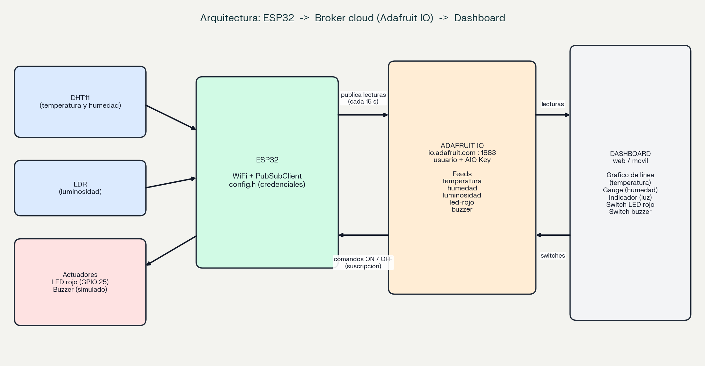

| Ruta | Recorrido | Protocolo |
|---|---|---|
| Lecturas | DHT11 / LDR → ESP32 → Adafruit IO → Dashboard | MQTT (usuario + AIO Key), cada 15 s |
| Comandos | Switch del dashboard → Adafruit IO → ESP32 → LED rojo / buzzer | MQTT (suscripción) |

El ESP32 se conecta al broker `io.adafruit.com` con el usuario de la cuenta y su AIO Key. Los tópicos siguen la estructura `usuario/feeds/clave-del-feed`.

## 2. Funcionalidades

- Lectura de temperatura y humedad (DHT11) y luminosidad (LDR, valor de 0 a 4095).
- Publicación en tres feeds: `temperatura`, `humedad` y `luminosidad`.
- Control remoto de `led-rojo` y `buzzer` desde dos switches del dashboard.
- Al reconectar, el ESP32 pide a Adafruit IO el último valor de los switches y lo aplica.
- Lógica local que sigue funcionando sin red: LEDs amarillo, verde y blanco con umbrales ajustables y histéresis de luz.
- Recuperación automática de WiFi y de MQTT, con diagnóstico de fallos y watchdog.
- Comandos por Monitor Serial para ajustar umbrales y probar fallos (`?` muestra la ayuda).
- Credenciales fuera del código (`config.h`, no se sube a GitHub).

> **Buzzer:** en esta entrega el buzzer es **simulado**: al recibir la orden, el Monitor Serial muestra la acción. Si se conecta un buzzer físico, se cambia `HAY_BUZZER` a `true`.

## 3. Hardware

| Componente | Pin del ESP32 | Observación |
|---|---|---|
| DHT11 (DATA) | GPIO 4 | VCC a 3V3 y GND a tierra común |
| LDR + resistencia de 10 kΩ | GPIO 34 | Divisor de tensión: 3V3 → LDR → nodo → 10 kΩ → GND |
| LED rojo | GPIO 25 | Con resistencia de 220 Ω; controlado desde el dashboard |
| LED amarillo | GPIO 26 | Con resistencia de 220 Ω; humedad baja |
| LED verde | GPIO 27 | Con resistencia de 220 Ω; estado normal |
| LED blanco | GPIO 33 | Con resistencia de 220 Ω; oscuridad |
| Buzzer (opcional) | GPIO 32 | Simulado por defecto |

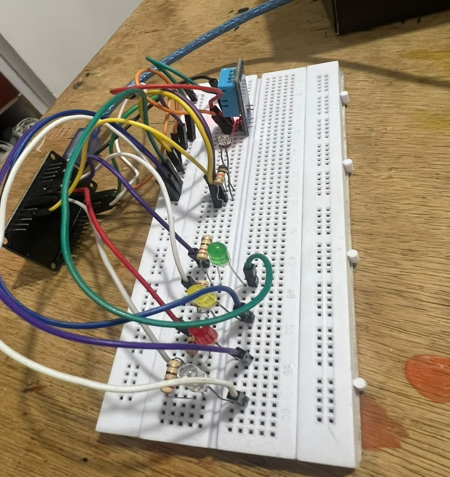

## 4. Configuración de Adafruit IO

1. Crea una cuenta en <https://io.adafruit.com>.
2. En **Feeds**, crea estos cinco feeds (la clave del feed debe coincidir):

| Feed | Clave | Tipo |
|---|---|---|
| temperatura | `temperatura` | Lectura |
| humedad | `humedad` | Lectura |
| luminosidad | `luminosidad` | Lectura |
| led-rojo | `led-rojo` | Control (ON / OFF) |
| buzzer | `buzzer` | Control (ON / OFF) |

3. En **Dashboards**, crea un dashboard y agrega estos bloques:

| Bloque | Feed | Función |
|---|---|---|
| Line Chart | `temperatura` | Histórico de temperatura |
| Gauge | `humedad` | Humedad actual (0 a 100 %) |
| Indicator | `luminosidad` | Cambia de color según la luz |
| Toggle | `led-rojo` | Switch del LED rojo (ON / OFF) |
| Toggle | `buzzer` | Switch del buzzer (ON / OFF) |

4. Con la llave amarilla de Adafruit IO, copia tu **usuario** y tu **AIO Key**.

## 5. Estructura del repositorio

```text
Semana12_Monitor_Aula_SJGrupo/
├── Semana12_Monitor_Aula_SJGrupo.ino   # Programa principal
├── config.example.h                    # Plantilla de credenciales (sin claves)
├── .gitignore                          # Excluye config.h
├── README.md
└── docs/
    └── img/                            # Diagrama y capturas
```

## 6. Cómo replicar el proyecto

1. Instala **Arduino IDE** y el paquete de placas **ESP32** (Espressif). Selecciona la placa `ESP32 Dev Module`.
2. Instala las librerías desde el Administrador de bibliotecas: **PubSubClient** (Nick O'Leary) y **DHTesp**.
3. Descarga o clona este repositorio y abre `Semana12_Monitor_Aula_SJGrupo.ino`.
4. **Credenciales:** copia `config.example.h` con el nombre `config.h` (en la misma carpeta) y completa tus datos:

```cpp
#define WIFI_SSID    "NOMBRE_DE_TU_RED"
#define WIFI_PASS    "CLAVE_DE_TU_RED"
#define AIO_USERNAME "TU_USUARIO_DE_ADAFRUIT_IO"
#define AIO_KEY      "TU_AIO_KEY"
```

5. Arma el circuito según la tabla de pines.
6. Crea los feeds y el dashboard (sección 4).
7. Compila y sube el programa. Abre el Monitor Serial a **115200** baudios, con fin de línea **Nueva línea**.
8. Debes ver la conexión al WiFi, la conexión autenticada a `io.adafruit.com` y, cada 15 segundos, la publicación de los tres sensores.
9. Abre el dashboard en el computador o en el celular y acciona los switches.

La red WiFi debe ser de **2,4 GHz**: el ESP32 no se conecta a redes de 5 GHz.

## 7. Comandos del Monitor Serial

| Comando | Efecto |
|---|---|
| `t 30` / `h 45` | Cambia la temperatura máxima / humedad mínima |
| `o 1200` / `c 2000` | Cambia los umbrales de oscuridad / claridad |
| `u` | Muestra los umbrales |
| `i` / `m` | Muestra los datos del WiFi / de Adafruit IO |
| `p` | Publica los datos ahora mismo |
| `a` | LED rojo y buzzer vuelven al modo automático |
| `k` | Simula la caída de la conexión MQTT |
| `d` | Simula la caída del WiFi (sin desconectar el cable) |
| `?` | Ayuda |

## 8. Pruebas realizadas y evidencias

| Prueba | Resultado | Evidencia |
|---|---|---|
| Conexión autenticada a Adafruit IO | Correcta | E01 |
| Publicación de temperatura, humedad y luminosidad | Datos visibles en los feeds y en el dashboard | E02 |
| Dashboard con 3 widgets de lectura y 2 de control | Funcional | E03, E04 |
| Control remoto del LED rojo desde el celular | El ESP32 recibe la orden y enciende o apaga el LED | E05 |
| Control del buzzer (acción simulada) | El ESP32 recibe la orden y la muestra por Serial | E06 |
| Pérdida de WiFi y recuperación (comando `d`) | Recuperación sin reiniciar | E07 |
| Recuperación del último estado de los switches | El ESP32 aplica el último valor al reconectar | E08 |
| Dashboard desde el celular | Funcional | E09 |

### E01 · Conexión al cloud (Monitor Serial)

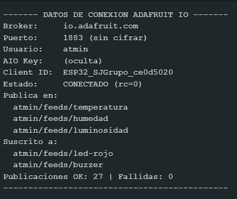
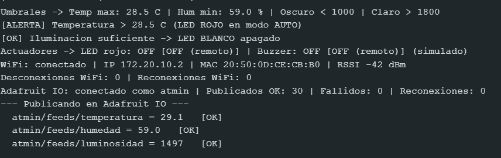
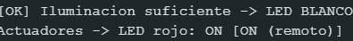
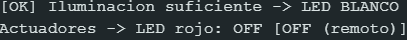


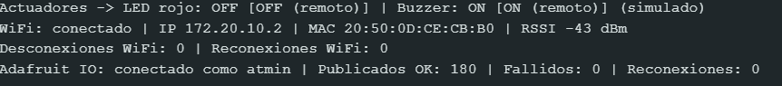
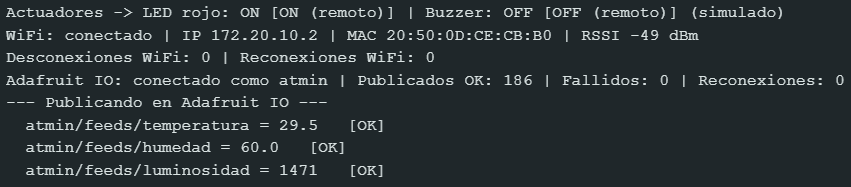

### E02 · Publicación de sensores

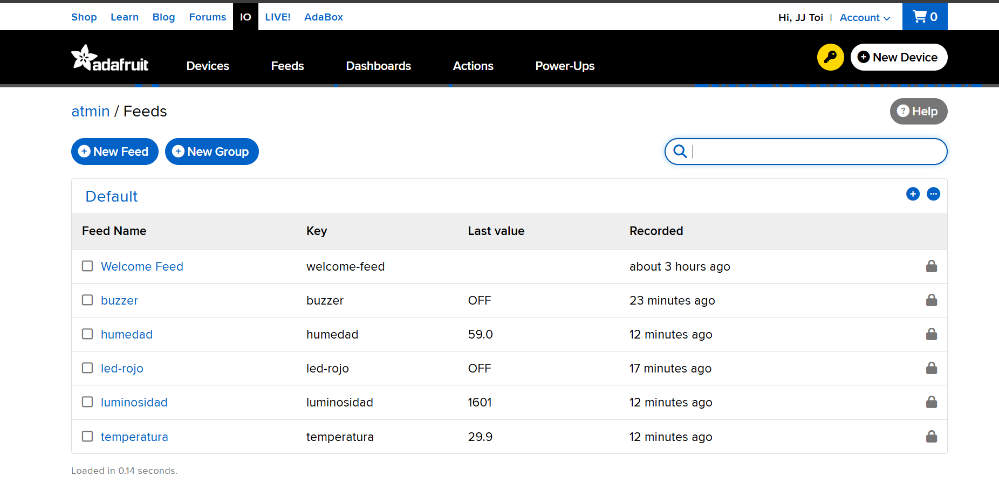
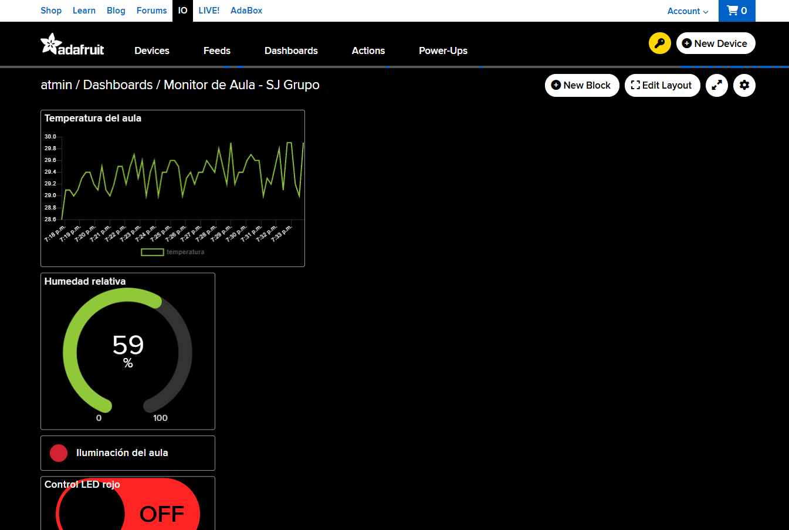

### E03 y E04 · Dashboard e indicador de luminosidad

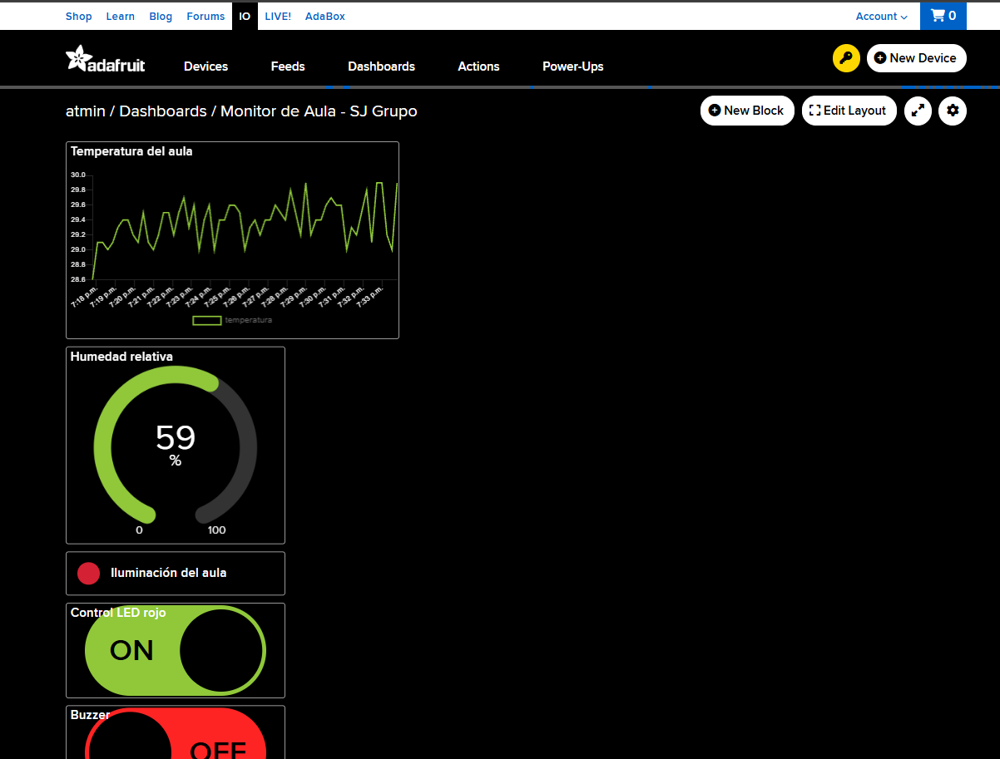
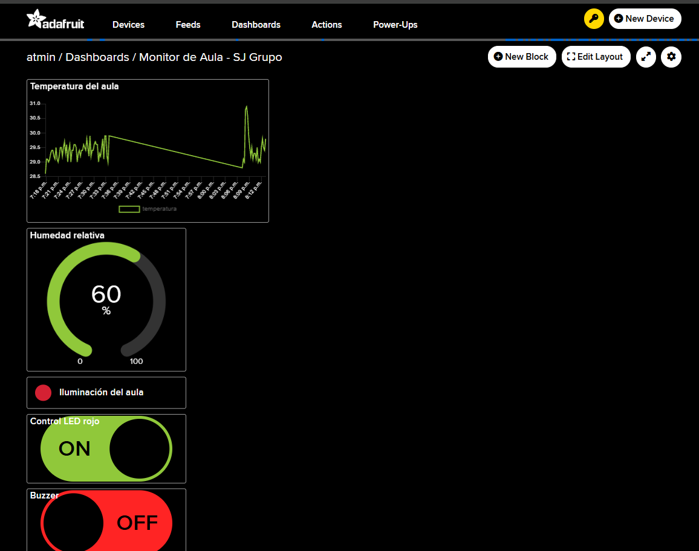
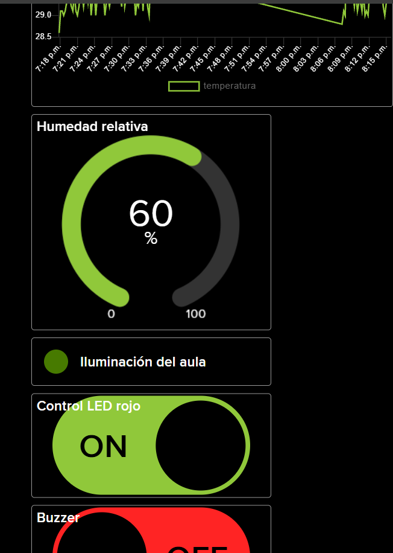

### E05 · Control del LED rojo desde el celular

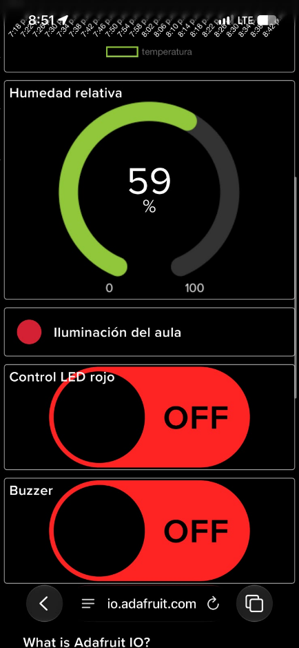 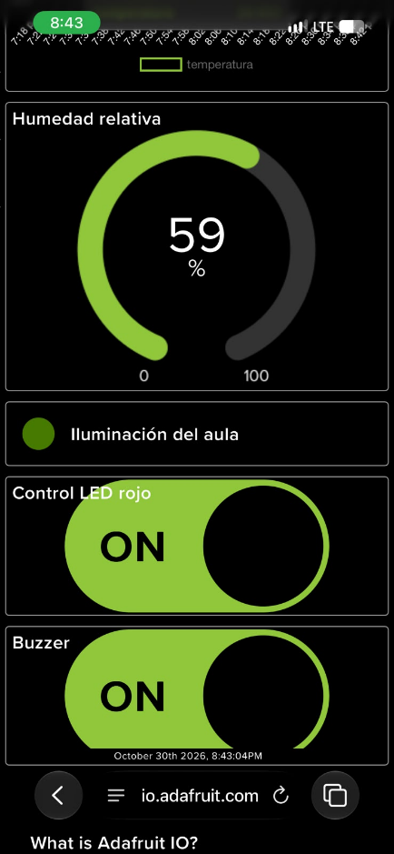

### E06 · Control del buzzer (simulado)

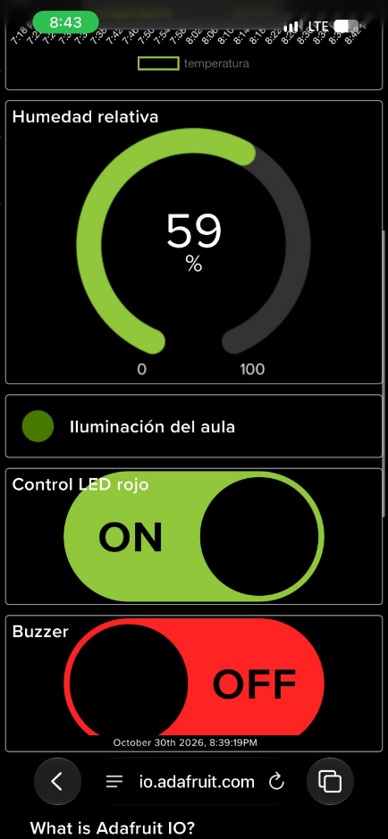 

### E07 y E08 · Resiliencia y último estado

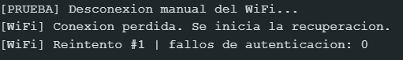
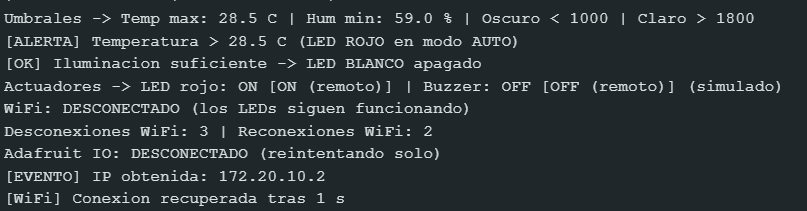
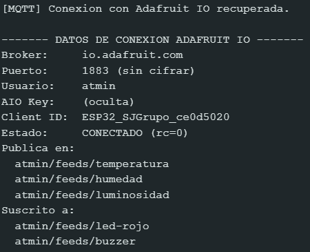
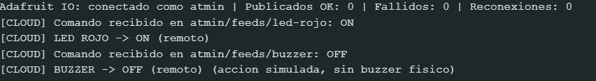

### E09 · Dashboard en el celular

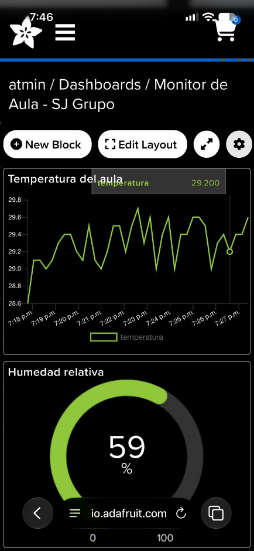

## 9. Seguridad de las credenciales

- `config.h` contiene el WiFi y la AIO Key reales y **no se sube**: está en `.gitignore`.
- El repositorio solo incluye `config.example.h`, con textos de ejemplo.
- El programa nunca imprime la AIO Key en el Monitor Serial.
- Si una clave se sube por error a GitHub, hay que **reemplazarla** en Adafruit IO: borrarla del repositorio después no elimina el historial.
- El puerto 1883 no cifra la comunicación. El código incluye la opción `USAR_TLS` (puerto 8883) que cifra el canal; en el modo de pruebas no valida el certificado del servidor.

## 10. Límites del plan gratuito y decisiones de diseño

- Adafruit IO limita la cantidad de datos por minuto; por eso se publica cada **15 segundos** (3 datos por ciclo, unos 12 por minuto).
- Adafruit IO no usa el mensaje retenido de MQTT para el último valor: al conectar, el programa solicita el último valor de cada switch publicando en `<feed>/get`.
- Publicar en un tópico que no sea de la cuenta puede hacer que el broker desconecte al cliente; por eso no se publica "estado" ni último testamento.
- El plan gratuito conserva el histórico un tiempo limitado (30 días, según la actividad). Para históricos anuales se debe exportar o guardar los datos en otra base.

## 11. Solución de problemas

| Síntoma | Causa probable | Qué hacer |
|---|---|---|
| `rc=4` o `rc=5` | Usuario o AIO Key incorrectos, o demasiados intentos por minuto | Revisa `config.h` |
| `rc=-2` | No se alcanza `io.adafruit.com` | Revisa Internet; algunas redes bloquean el puerto 1883 |
| Conecta pero no hay datos | La clave de un feed no coincide con el tópico | Verifica las claves de los cinco feeds |
| El LED rojo no responde a la temperatura | Un switch del dashboard lo dejó en modo manual | Escribe `a` en el Monitor Serial |
| No conecta al WiFi | Red de 5 GHz o clave incorrecta | Usa una red de 2,4 GHz y revisa `config.h` |

## 12. Limitaciones

- El buzzer físico no está conectado: su acción es simulada.
- Las lecturas no se guardan en el ESP32 mientras no hay red.
- El indicador de luminosidad del dashboard usa un solo umbral; el LED blanco del montaje usa dos (histéresis).

## 13. Autores

- Santiago Torres
- Julián Tarazona

Equipo **SJ Grupo** · Grupo B192 · Internet de las Cosas (IoT) · Universitaria Tecnológica de Santander · octubre de 2026
