# Alerta de luminosidad con ESP32, Adafruit IO e IFTTT (Semana 13)

Proyecto de **Internet de las Cosas (IoT) – TSI519**, Universitaria Tecnológica de Santander.  
Equipo **SJ Grupo**: Santiago Torres y Julián Tarazona · Grupo B192.

## Descripción del proyecto

El coordinador académico no puede estar frente al dashboard todo el día, pero necesita enterarse cuando la iluminación del aula cae por debajo de un nivel crítico. Este proyecto construye el flujo completo:

un **ESP32** lee un sensor de luminosidad (**LDR**), publica el dato en un feed de **Adafruit IO** por MQTT, un **Applet de IFTTT** vigila el feed (Trigger → Action) y envía una **notificación push** al celular cuando la lectura es menor que el umbral.

> **Aclaración importante sobre las unidades.** El LDR entrega una lectura **ADC (0 a 4095)**, no lux. Convertirla a lux exige calibrarla con una referencia. Por eso el proyecto trabaja con **ADC < 100** como umbral de demostración y no presenta ningún valor como lux. Con luz artificial, el sensor descubierto marca entre 1323 y 1458 y tapado entre 23 y 30.

## Flujo: Sensor → ESP32 → Adafruit IO → IFTTT → Notificación push

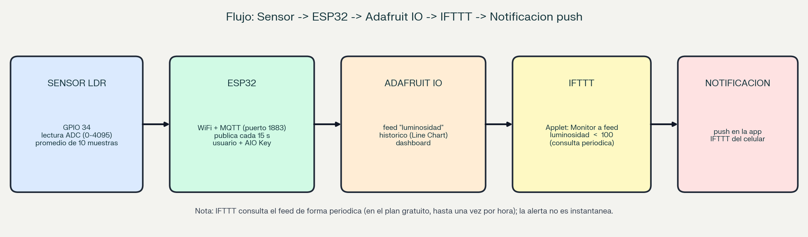

| Paso | Componente | Qué hace |
|---|---|---|
| 1 | Sensor LDR | Cambia su resistencia con la luz; el divisor de tensión la convierte en voltaje (GPIO 34) |
| 2 | ESP32 | Lee el ADC (promedio de 10 muestras) cada 2 s y publica cada 15 s por MQTT, con usuario y AIO Key |
| 3 | Adafruit IO | Guarda el dato en el feed `luminosidad` y lo muestra en el dashboard |
| 4 | IFTTT | El Applet vigila el feed y evalúa la condición `luminosidad < 100` |
| 5 | Notificación push | La aplicación IFTTT avisa en el celular |

El ESP32 solo publica el dato; la regla y la notificación las gestiona IFTTT, de modo que se pueden cambiar sin modificar el firmware.

## Diagrama de conexión del sensor al ESP32

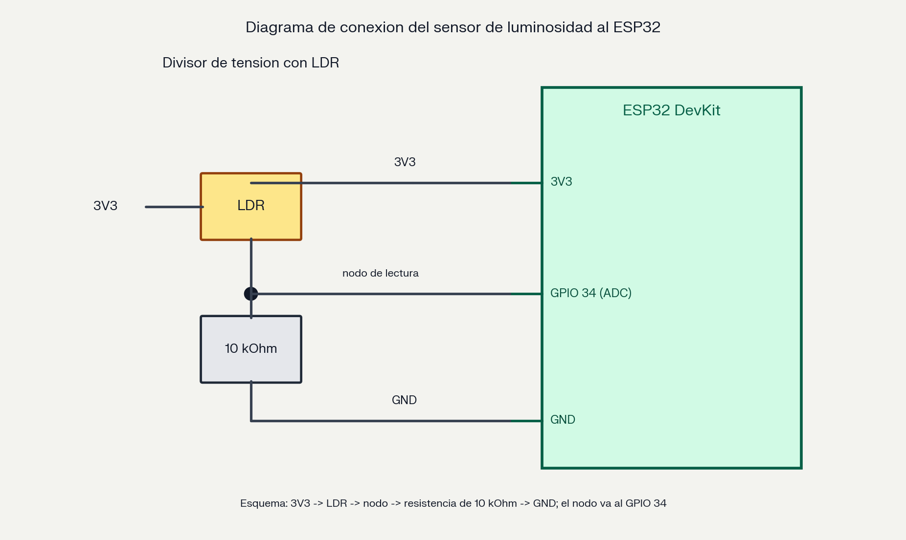

| Componente | Pin | Observación |
|---|---|---|
| LDR (nodo del divisor) | GPIO 34 | Entrada analógica (ADC de 12 bits) |
| Resistencia de 10 kΩ | GND | `3V3 → LDR → nodo → 10 kΩ → GND` |
| LED blanco + resistencia | GPIO 33 | Indicador local: se enciende con ADC < 100 |

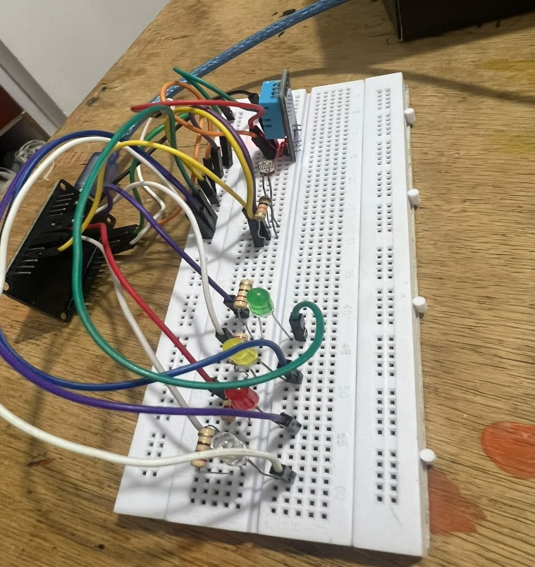

## Estructura del repositorio

```text
proyecto-iot-semana13/
├── README.md
├── .gitignore
├── codigo/
│   ├── esp32_luminosidad.ino
│   └── config.example.h
├── evidencias/
│   ├── applet_ifttt.png
│   ├── notificacion_push.png
│   ├── grafico_historico.png
│   ├── dashboard_adafruit.png
│   └── ... (demás capturas y diagramas)
└── informe_tecnico.md
```

## Cómo replicar el proyecto

1. **Monta el sensor** según el diagrama: `3V3 → LDR → nodo → 10 kΩ → GND`, con el nodo en GPIO 34.
2. **Adafruit IO:** crea una cuenta, un feed llamado `luminosidad` y copia tu usuario y tu AIO Key (icono de la llave).
3. **Arduino IDE:** instala el soporte para ESP32 y la librería **PubSubClient**. Crea una carpeta `esp32_luminosidad` y copia dentro `codigo/esp32_luminosidad.ino` (el IDE exige que la carpeta se llame igual que el `.ino`).
4. **Credenciales:** copia `codigo/config.example.h` como `config.h` en esa misma carpeta y completa el WiFi (2,4 GHz) y tus datos de Adafruit IO. `config.h` no se sube a GitHub.
5. Selecciona la placa `ESP32 Dev Module`, sube el programa y abre el Monitor Serial a **115200** baudios con fin de línea **Nueva línea**.
6. Comprueba que se conecta a `io.adafruit.com` y publica cada 15 s. Cubre y descubre el sensor para ver cambiar la lectura.
7. **Dashboard:** crea un dashboard con un **Line Chart** asociado al feed `luminosidad`.
8. **IFTTT:** crea un Applet. *If This:* Adafruit → *Monitor a feed on Adafruit IO* → feed `luminosidad`, *Less than*, `100`. *Then That:* Notifications → *Send a notification from the IFTTT app*, con este mensaje:

```text
ALERTA: Luminosidad baja en el aula.
Lectura del LDR: [valor del feed] ADC.
Umbral de demostracion: menor que 100 ADC.
Verificar iluminacion.
```

9. Instala la aplicación **IFTTT** en el celular e inicia sesión con **la misma cuenta** del Applet; permite las notificaciones.
10. Tapa el sensor para producir una lectura menor que 100 y espera la notificación.

## Capturas de pantalla exigidas

### Applet de IFTTT

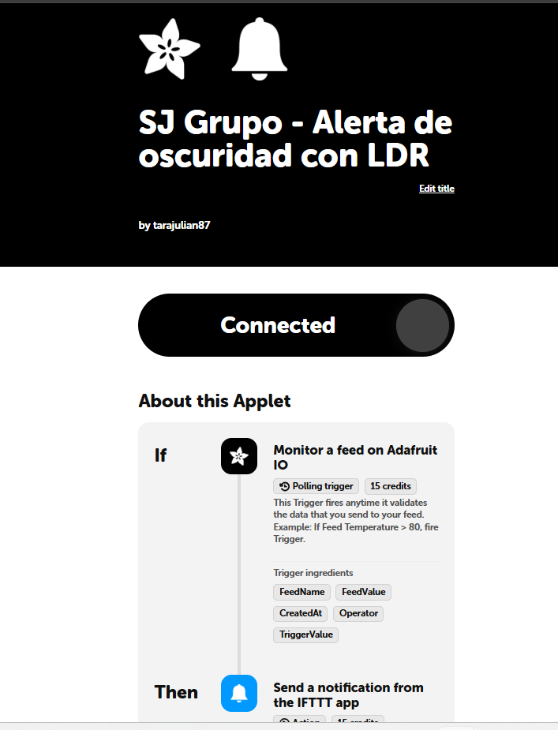

### Notificación push recibida en el celular

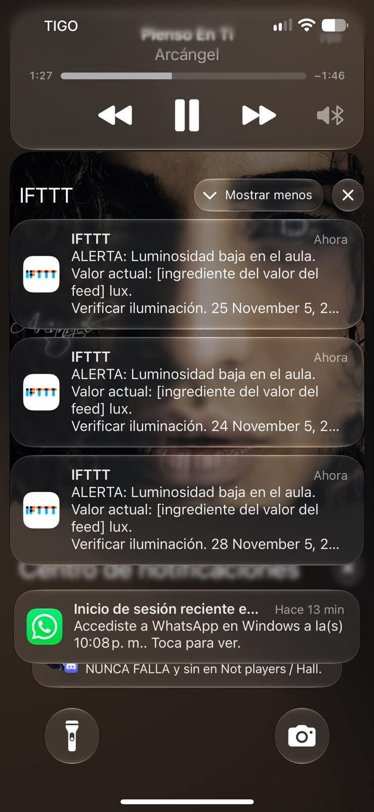

> **PENDIENTE DE COMPLETAR:** reemplazar `evidencias/notificacion_push.png` por la captura del celular con la notificación recibida.

### Registro de actividad de IFTTT

El primer intento mostró que el disparador de Adafruit se ejecutó, pero la acción de notificación falló por falta de una sesión válida en la aplicación móvil:

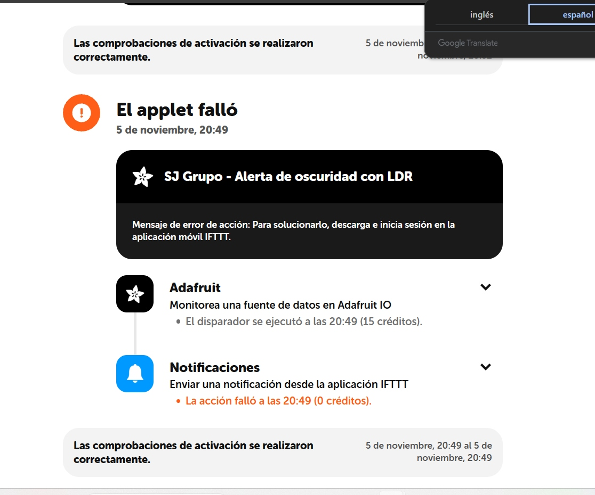

Tras iniciar sesión de nuevo en la aplicación, la nueva ejecución debe registrarse así:

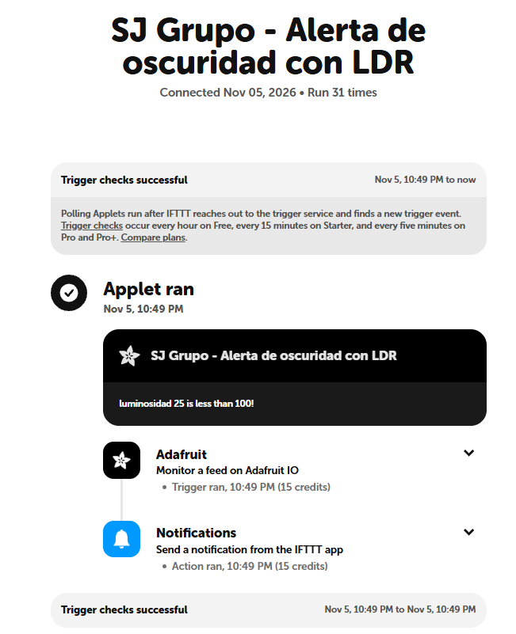

> **PENDIENTE DE COMPLETAR:** reemplazar `evidencias/ifttt_actividad_exitosa.png` por la captura de la ejecución exitosa.

### Gráfico histórico (Line Chart)

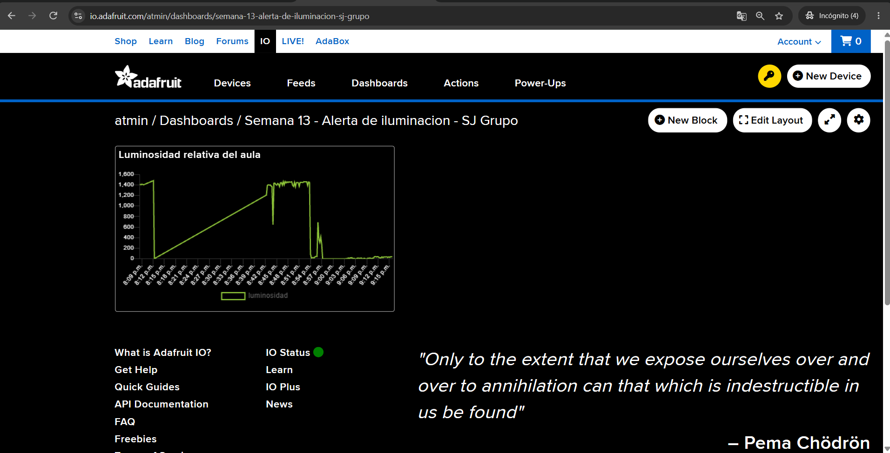

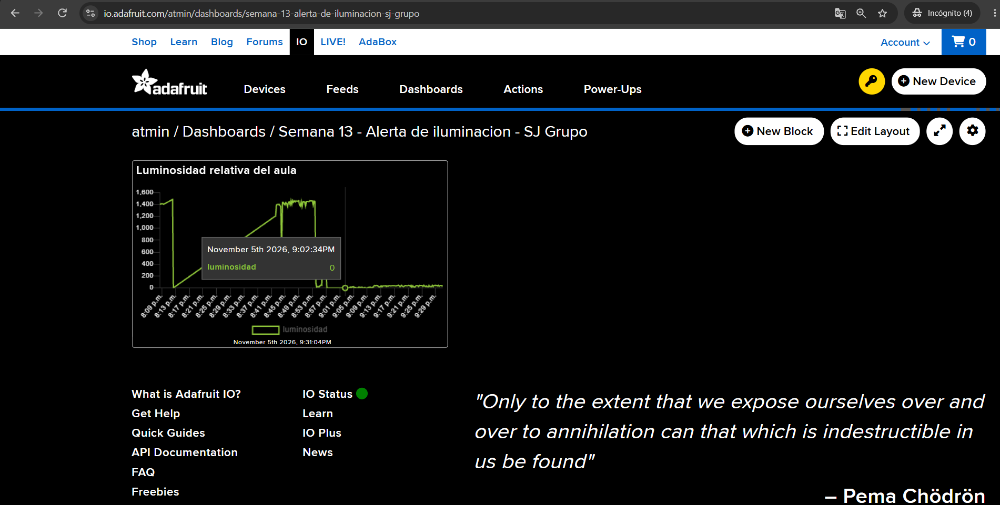

### Dashboard de Adafruit IO

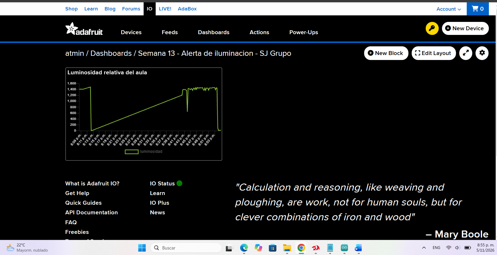

### Feed con datos y Monitor Serial


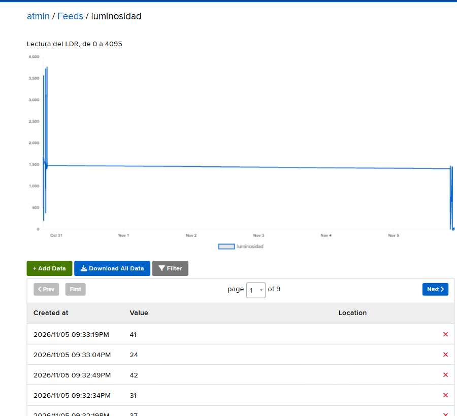

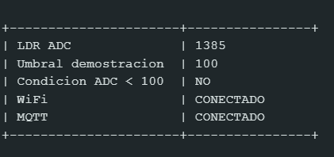
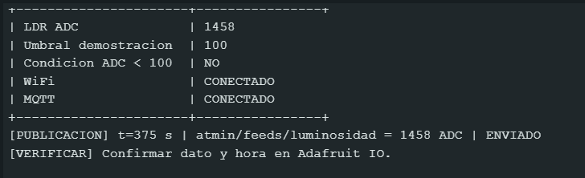
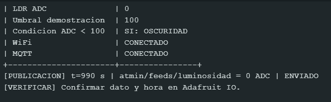

### Configuración de IFTTT

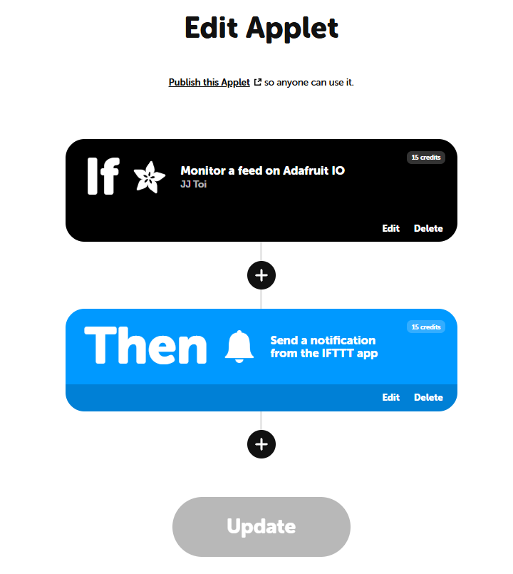
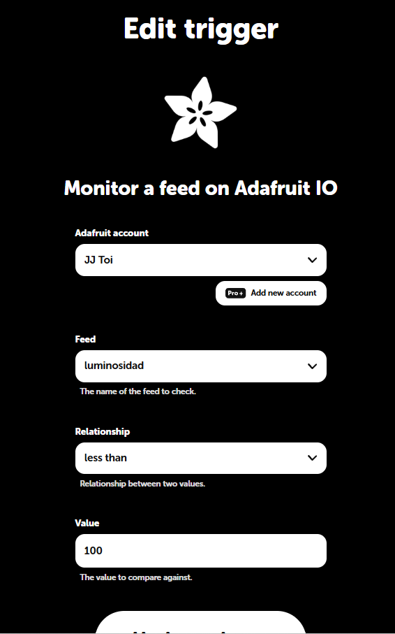

## Resultados

| Prueba | Resultado |
|---|---|
| El LDR varía al cubrir y descubrir | Correcto (1323–1458 ADC descubierto; 23–30 ADC tapado) |
| Publicación en `luminosidad` cada 15 s | Correcto |
| Histórico de al menos cinco minutos | Correcto |
| Applet configurado y activo | Correcto |
| Disparador de IFTTT | Se ejecutó (5 de noviembre, 20:49) |
| Notificación push recibida | Correcto |

## Código fuente comentado

Archivo completo: [`codigo/esp32_luminosidad.ino`](codigo/esp32_luminosidad.ino). El programa lee el LDR (promedio de 10 muestras), publica en `usuario/feeds/luminosidad` cada 15 s, recupera WiFi y MQTT sin bloquear el programa e imprime lecturas y publicaciones por el Monitor Serial.

<details>
<summary>Ver el código completo</summary>

```cpp
/*
  SEMANA 13 - ALERTA DE LUMINOSIDAD CON IFTTT
  Equipo: SJ Grupo

  Flujo:
    LDR -> ESP32 -> Adafruit IO -> IFTTT -> notificacion push

  Sensor:
    3V3 -> LDR -> nodo -> resistencia 10 kohm -> GND
                    |
                 GPIO 34

  IMPORTANTE:
    Se publica la lectura ADC del LDR (0 a 4095).
    NO es una medicion en lux.
    El umbral 100 corresponde a ADC para la demostracion.
    Para expresar lux hace falta calibracion con referencia.

  LED blanco:
    GPIO 33, con su resistencia existente.
    Encendido si ADC < 100.

  Comandos del Monitor Serial:
    i -> datos WiFi
    m -> datos MQTT
    p -> solicitar publicacion (respeta intervalo de 15 s)
    d -> desconectar WiFi; se recupera automaticamente
    k -> desconectar MQTT; se recupera automaticamente
    ? -> ayuda

  Monitor Serial: 115200 baudios y Nueva linea.
  Credenciales: config.h (NO subir a GitHub).

  MQTT 1883: autenticado, pero sin cifrado.
*/

#include <WiFi.h>
#include <PubSubClient.h>
#include "config.h"

// ---------- Pines ----------
const uint8_t LDR_PIN = 34;
const uint8_t LED_BLANCO = 33;

// Los otros LEDs quedan apagados en esta version.
const uint8_t LED_ROJO = 25;
const uint8_t LED_AMARILLO = 26;
const uint8_t LED_VERDE = 27;

// ---------- Sensor ----------
const uint32_t INTERVALO_LECTURA = 2000;
const int UMBRAL_OSCURIDAD_ADC = 100;
const bool LDR_INVERTIDA = false;

// ---------- MQTT ----------
const char* MQTT_SERVER = "io.adafruit.com";
const uint16_t MQTT_PORT = 1883;

const uint32_t INTERVALO_PUBLICACION = 15000;
const uint32_t INTERVALO_REINTENTO_MQTT = 15000;

// ---------- WiFi ----------
const uint32_t INTERVALO_REINTENTO_WIFI = 15000;

// ---------- Objetos ----------
WiFiClient clienteRed;
PubSubClient mqtt(clienteRed);

// ---------- Topicos ----------
String topicLuz;
String topicErrores;
String topicLimite;
String clientId;

// ---------- Estado ----------
int ultimaLuz = 0;
bool hayLectura = false;

bool wifiAnterior = false;
bool mqttAnterior = false;

bool primeraConexionWiFi = true;
bool primerIntentoMQTT = true;
bool primerEnvio = true;
bool envioSolicitado = false;

uint32_t ultimaLectura = 0;
uint32_t ultimoEnvio = 0;
uint32_t ultimoIntentoWiFi = 0;
uint32_t ultimoIntentoMQTT = 0;

uint32_t publicados = 0;
uint32_t fallidos = 0;
uint32_t reconexionesMQTT = 0;
bool algunaConexionMQTT = false;

String lineaSerial;

// ---------- Ayuda ----------
void mostrarAyuda() {
  Serial.println();
  Serial.println("--------------- COMANDOS ---------------");
  Serial.println("i -> datos WiFi");
  Serial.println("m -> datos MQTT");
  Serial.println("p -> solicitar envio (respeta 15 s)");
  Serial.println("d -> desconectar WiFi y probar recuperacion");
  Serial.println("k -> desconectar MQTT y probar recuperacion");
  Serial.println("? -> ayuda");
  Serial.println("----------------------------------------");
}

// ---------- Datos WiFi ----------
void mostrarWiFi() {
  Serial.println();
  Serial.println("----------- DATOS WIFI -----------");

  if (WiFi.status() != WL_CONNECTED) {
    Serial.print("Estado: DESCONECTADO | codigo ");
    Serial.println((int)WiFi.status());
    return;
  }

  Serial.print("IP:      ");
  Serial.println(WiFi.localIP());

  Serial.print("MAC:     ");
  Serial.println(WiFi.macAddress());

  Serial.print("Gateway: ");
  Serial.println(WiFi.gatewayIP());

  Serial.print("RSSI:    ");
  Serial.print(WiFi.RSSI());
  Serial.println(" dBm");

  Serial.println("----------------------------------");
}

// ---------- Datos MQTT ----------
void mostrarMQTT() {
  Serial.println();
  Serial.println("-------- DATOS ADAFRUIT IO --------");

  Serial.print("Broker:  ");
  Serial.println(MQTT_SERVER);

  Serial.print("Puerto:  ");
  Serial.print(MQTT_PORT);
  Serial.println(" (sin cifrado)");

  Serial.print("Usuario: ");
  Serial.println(AIO_USERNAME);

  Serial.println("AIO Key: (oculta)");

  Serial.print("Estado:  ");
  Serial.println(mqtt.connected() ? "CONECTADO" : "DESCONECTADO");

  Serial.print("rc:      ");
  Serial.println(mqtt.state());

  Serial.print("Feed:    ");
  Serial.println(topicLuz);

  Serial.println("Unidad:  ADC, NO lux");

  Serial.print("Enviados por la funcion publish: ");
  Serial.println(publicados);

  Serial.print("Intentos fallidos: ");
  Serial.println(fallidos);

  Serial.print("Reconexiones MQTT: ");
  Serial.println(reconexionesMQTT);

  Serial.println("----------------------------------");
}

// ---------- Mensajes del broker ----------
void callbackMQTT(
  char* topic,
  byte* payload,
  unsigned int length
) {
  Serial.print("[ADAFRUIT] ");
  Serial.print(topic);
  Serial.print(" -> ");

  for (unsigned int i = 0; i < length; i++) {
    Serial.write(payload[i]);
  }

  Serial.println();
}

// ---------- Lectura real del LDR ----------
int leerLDR() {
  long suma = 0;

  for (int i = 0; i < 10; i++) {
    suma += analogRead(LDR_PIN);
    delay(5);
  }

  int lectura = suma / 10;

  if (LDR_INVERTIDA) {
    lectura = 4095 - lectura;
  }

  return lectura;
}

// ---------- Lectura y control local ----------
void revisarSensor() {
  uint32_t ahora = millis();

  if (ahora - ultimaLectura < INTERVALO_LECTURA) {
    return;
  }

  ultimaLectura = ahora;
  ultimaLuz = leerLDR();
  hayLectura = true;

  bool oscuridad = ultimaLuz < UMBRAL_OSCURIDAD_ADC;

  digitalWrite(LED_BLANCO, oscuridad ? HIGH : LOW);

  Serial.println();
  Serial.println("+----------------------+----------------+");

  Serial.print("| LDR ADC              | ");
  Serial.println(ultimaLuz);

  Serial.print("| Umbral demostracion  | ");
  Serial.println(UMBRAL_OSCURIDAD_ADC);

  Serial.print("| Condicion ADC < 100  | ");
  Serial.println(oscuridad ? "SI: OSCURIDAD" : "NO");

  Serial.print("| WiFi                 | ");
  Serial.println(
    WiFi.status() == WL_CONNECTED ? "CONECTADO" : "DESCONECTADO"
  );

  Serial.print("| MQTT                 | ");
  Serial.println(mqtt.connected() ? "CONECTADO" : "DESCONECTADO");

  Serial.println("+----------------------+----------------+");
}

// ---------- WiFi ----------
void revisarWiFi() {
  bool conectado = WiFi.status() == WL_CONNECTED;

  if (conectado && !wifiAnterior) {
    Serial.println("[WiFi] Conexion establecida o recuperada.");
    mostrarWiFi();
    primerIntentoMQTT = true;
  }

  if (!conectado && wifiAnterior) {
    Serial.println("[WiFi] Conexion perdida.");

    // Cerrar cualquier conexion TCP anterior.
    clienteRed.stop();
    mqttAnterior = false;

    // Dar tiempo antes de un nuevo intento.
    ultimoIntentoWiFi = millis();
  }

  wifiAnterior = conectado;

  if (conectado) {
    return;
  }

  uint32_t ahora = millis();

  if (ahora - ultimoIntentoWiFi < INTERVALO_REINTENTO_WIFI) {
    return;
  }

  ultimoIntentoWiFi = ahora;

  Serial.println("[WiFi] Reintentando conexion...");
  WiFi.reconnect();
}

// ---------- MQTT ----------
void revisarMQTT() {
  if (WiFi.status() != WL_CONNECTED) {
    return;
  }

  if (mqtt.connected()) {
    mqtt.loop();
    return;
  }

  if (mqttAnterior) {
    mqttAnterior = false;
    Serial.println("[MQTT] Conexion perdida.");
  }

  uint32_t ahora = millis();

  if (
    !primerIntentoMQTT &&
    ahora - ultimoIntentoMQTT < INTERVALO_REINTENTO_MQTT
  ) {
    return;
  }

  primerIntentoMQTT = false;
  ultimoIntentoMQTT = ahora;

  Serial.print("[MQTT] Conectando a Adafruit IO como ");
  Serial.print(AIO_USERNAME);
  Serial.println("...");

  bool ok = mqtt.connect(
    clientId.c_str(),
    AIO_USERNAME,
    AIO_KEY
  );

  if (!ok) {
    Serial.print("[MQTT] Fallo. rc=");
    Serial.println(mqtt.state());
    Serial.println(
      "[MQTT] rc=4/5: revisar usuario, AIO Key o limites de acceso."
    );
    return;
  }

  if (algunaConexionMQTT) {
    reconexionesMQTT++;
  }

  algunaConexionMQTT = true;
  mqttAnterior = true;

  mqtt.subscribe(topicErrores.c_str());
  mqtt.subscribe(topicLimite.c_str());

  Serial.println("[MQTT] Conexion autenticada correcta.");
  mostrarMQTT();
}

// ---------- Publicacion ----------
void revisarPublicacion() {
  if (!hayLectura || !mqtt.connected()) {
    return;
  }

  uint32_t ahora = millis();
  bool intervaloCumplido =
    primerEnvio ||
    ahora - ultimoEnvio >= INTERVALO_PUBLICACION;

  if (!intervaloCumplido) {
    return;
  }

  // El envio automatico ya ocurre cada 15 segundos.
  // El comando p no salta esta separacion.
  primerEnvio = false;
  envioSolicitado = false;
  ultimoEnvio = ahora;

  String valor = String(ultimaLuz);

  bool ok = mqtt.publish(
    topicLuz.c_str(),
    valor.c_str()
  );

  if (ok) {
    publicados++;
  } else {
    fallidos++;
  }

  Serial.print("[PUBLICACION] t=");
  Serial.print(ahora / 1000);
  Serial.print(" s | ");
  Serial.print(topicLuz);
  Serial.print(" = ");
  Serial.print(valor);
  Serial.print(" ADC | ");
  Serial.println(ok ? "ENVIADO" : "FALLO");

  if (ok) {
    Serial.println(
      "[VERIFICAR] Confirmar dato y hora en Adafruit IO."
    );
  }
}

// ---------- Comandos ----------
void procesarComando(String comando) {
  comando.trim();
  comando.toLowerCase();

  if (comando.length() == 0) {
    return;
  }

  if (comando == "i") {
    mostrarWiFi();
  } else if (comando == "m") {
    mostrarMQTT();
  } else if (comando == "?") {
    mostrarAyuda();
  } else if (comando == "d") {
    Serial.println(
      "[PRUEBA] Desconexion WiFi sin quitar el USB."
    );

    // No se borran credenciales ni se apaga la radio.
    clienteRed.stop();
    WiFi.disconnect(false, false);

    ultimoIntentoWiFi = millis();
  } else if (comando == "k") {
    Serial.println(
      "[PRUEBA] Desconexion MQTT. No se apaga el broker."
    );

    mqtt.disconnect();
    mqttAnterior = false;
    primerIntentoMQTT = false;
    ultimoIntentoMQTT = millis();
  } else if (comando == "p") {
    envioSolicitado = true;

    Serial.println(
      "[ENVIO] Se publicara en el siguiente turno permitido."
    );
  } else {
    Serial.println("[COMANDO] No reconocido. Escribe ?.");
  }
}

void revisarSerial() {
  while (Serial.available() > 0) {
    char c = Serial.read();

    if (c == '\n' || c == '\r') {
      procesarComando(lineaSerial);
      lineaSerial = "";
    } else if (lineaSerial.length() < 40) {
      lineaSerial += c;
    }
  }
}

// ---------- Inicio ----------
void setup() {
  Serial.begin(115200);
  delay(500);

  pinMode(LDR_PIN, INPUT);
  analogReadResolution(12);

  pinMode(LED_BLANCO, OUTPUT);
  pinMode(LED_ROJO, OUTPUT);
  pinMode(LED_AMARILLO, OUTPUT);
  pinMode(LED_VERDE, OUTPUT);

  digitalWrite(LED_BLANCO, LOW);
  digitalWrite(LED_ROJO, LOW);
  digitalWrite(LED_AMARILLO, LOW);
  digitalWrite(LED_VERDE, LOW);

  String usuario = String(AIO_USERNAME);

  topicLuz = usuario + "/feeds/luminosidad";
  topicErrores = usuario + "/errors";
  topicLimite = usuario + "/throttle";

  clientId =
    "SJGrupo_S13_" +
    String((uint32_t)ESP.getEfuseMac(), HEX);

  mqtt.setServer(MQTT_SERVER, MQTT_PORT);
  mqtt.setCallback(callbackMQTT);
  mqtt.setKeepAlive(30);
  mqtt.setSocketTimeout(5);

  WiFi.persistent(false);
  WiFi.mode(WIFI_STA);
  WiFi.setAutoReconnect(true);
  WiFi.begin(WIFI_SSID, WIFI_PASS);

  ultimoIntentoWiFi = millis();

  Serial.println();
  Serial.println("========================================");
  Serial.println(" SEMANA 13 - SJ GRUPO");
  Serial.println(" LDR -> Adafruit IO -> IFTTT -> Push");
  Serial.println(" Unidad: ADC. NO es lux.");
  Serial.println(" Umbral demostrativo: ADC < 100");
  Serial.println(" Publicacion: cada 15 segundos");
  Serial.println("========================================");

  mostrarAyuda();
}

// ---------- Ciclo ----------
void loop() {
  revisarSensor();
  revisarWiFi();
  revisarMQTT();
  revisarSerial();
  revisarPublicacion();

  delay(1);
}
```

</details>

## Limitaciones y decisiones de diseño

- **ADC en lugar de lux:** sin calibración con una referencia, el LDR no entrega lux. El umbral `ADC < 100` es de demostración y debe confirmarse con el docente.
- **La alerta no es inmediata:** el disparador de Adafruit en IFTTT es de consulta periódica; en el plan gratuito puede comprobarse hasta una vez por hora.
- **Créditos de IFTTT:** cada paso del Applet consume créditos y, si se agotan, los Applets se pausan. Conviene desactivarlo al terminar las pruebas.
- **Puerto 1883:** la conexión está autenticada pero no cifrada.
- **Plan gratuito de Adafruit IO:** conserva el histórico un tiempo limitado (30 días, según la guía) y limita los datos por minuto, por eso se publica cada 15 s.

## Seguridad de las credenciales

`config.h` (WiFi y AIO Key reales) está en `.gitignore` y **no se sube**. El repositorio solo contiene `config.example.h`. Si una clave se sube por error, hay que reemplazarla en Adafruit IO.

## Conclusiones sobre la utilidad de la automatización en IoT

- La automatización evita que una persona tenga que vigilar un dashboard: el sistema detecta la condición y avisa solo cuando se cumple.
- Separar la captura del dato (ESP32) de la regla y la acción (IFTTT) permite cambiar el umbral o el tipo de aviso sin reprogramar el dispositivo.
- Aun así, hay que conocer los límites del servicio: consulta periódica, créditos, retención de datos y dependencia de una sesión válida en la aplicación móvil.

## Informe técnico

Consulta [`informe_tecnico.md`](informe_tecnico.md) para el desarrollo completo, el análisis de tendencia, los problemas encontrados y las respuestas a las preguntas de reflexión.

## Autores

Santiago Torres · Julián Tarazona — SJ Grupo, Grupo B192 · Universitaria Tecnológica de Santander · noviembre de 2026
