# Informe técnico – Semana 13: Alerta de luminosidad con ESP32, Adafruit IO e IFTTT

**Asignatura:** Internet de las Cosas (IoT) – TSI519  
**Programa:** Tecnología en Desarrollo de Sistemas Informáticos – Universitaria Tecnológica de Santander  
**Equipo:** SJ Grupo · **Integrantes:** Santiago Torres y Julián Tarazona · **Grupo:** B192  
**Fecha:** 5 de noviembre de 2026


## 1. Introducción y situación problema

El coordinador académico de la institución no puede permanecer frente al dashboard de Adafruit IO todo el día revisando los datos ambientales del aula, pero necesita ser notificado de forma inmediata cuando ocurra una anomalía, por ejemplo, cuando la luminosidad del aula descienda por debajo de un umbral crítico.

Para resolver esta necesidad se construyó un flujo completo de IoT: un ESP32 lee un sensor de luminosidad (LDR), publica el dato en un feed de Adafruit IO, un Applet de IFTTT vigila ese feed bajo el modelo Trigger-Action (This → That) y, cuando se cumple la condición, envía una notificación push al celular del coordinador.

El proyecto reutiliza el montaje y la conexión MQTT autenticada de la semana 12 (Monitor de Aula Conectado) y los reduce a lo esencial para esta actividad: un solo sensor, un solo feed y una regla de alerta.


## 2. Objetivos

- Configurar un feed en Adafruit IO para el envío de datos de luminosidad desde el ESP32.
- Diseñar una visualización histórica (Line Chart) que permita analizar tendencias.
- Crear un Applet en IFTTT bajo el modelo Trigger-Action (This → That).
- Integrar el ESP32 con la nube y validar la recepción de notificaciones push en el celular.
- Documentar el proceso en GitHub con evidencias verificables.


## 3. Materiales y herramientas

| Recurso | Descripción |
|---|---|
| Hardware | ESP32 DevKit, sensor de luminosidad LDR con resistencia de 10 kΩ (divisor de tensión), protoboard y cables |
| Indicador local | LED blanco con su resistencia en GPIO 33 (se enciende con la condición de oscuridad) |
| Software | Arduino IDE con las librerías WiFi.h y PubSubClient.h |
| Cuentas | Adafruit IO (gratuita), IFTTT (gratuita), GitHub y la aplicación IFTTT en el celular |
| Red | Conexión WiFi de 2,4 GHz con acceso a Internet |

La guía menciona también la librería Adafruit_MQTT.h. Se conservó PubSubClient, que ya se utilizó en las semanas 10 y 12, porque cumple la misma función con el mismo broker y evita reescribir el código de conexión y recuperación.


## 4. Decisión sobre las unidades: ADC y no lux

La guía plantea una alerta cuando la luminosidad desciende por debajo de 100 lux. El equipo dispone únicamente de un LDR, cuya lectura en el ESP32 es un valor ADC de 12 bits (0 a 4095), no una medida en lux. Convertir ese valor a lux exige caracterizar el LDR y calibrarlo con una referencia (DigiKey, s. f.), algo que no se podía hacer sin un luxómetro o un sensor como el BH1750.

Por esa razón, toda la práctica trabaja con lectura ADC y no se presenta ningún valor como lux. El umbral de la alerta es ADC < 100 y se usa como umbral de demostración.

| Condición del montaje (habitación con luz artificial) | Lectura ADC aproximada |
|---|---|
| LDR descubierto | 1323 a 1458 |
| LDR tapado | 23 a 30 |
| Umbral de alerta | menor que 100 |

Con esos valores, la condición ADC < 100 se cumple solo cuando el sensor se tapa, por lo que permite probar el flujo completo con una lectura real. Esta diferencia con el enunciado (100 lux) queda declarada como limitación y se debe confirmar con el docente.


## 5. Arquitectura y flujo de datos

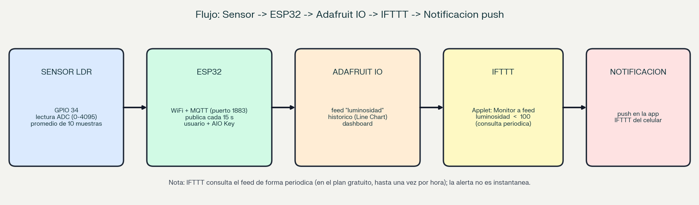

*Flujo del sistema: Sensor → ESP32 → Adafruit IO → IFTTT → notificación push.*

| Paso | Componente | Qué hace |
|---|---|---|
| 1 | Sensor LDR | Cambia su resistencia con la luz; el divisor de tensión la convierte en un voltaje en GPIO 34 |
| 2 | ESP32 | Lee el ADC (promedio de 10 muestras) cada 2 s y publica cada 15 s por MQTT, con usuario y AIO Key |
| 3 | Adafruit IO | Recibe el dato en el feed luminosidad, lo guarda y lo muestra en el dashboard |
| 4 | IFTTT | El Applet vigila el feed y compara el valor: luminosidad menor que 100 |
| 5 | Notificación push | Si se cumple la condición, la aplicación IFTTT envía el mensaje al celular |

El ESP32 no envía la notificación: solo publica el dato. La evaluación de la condición y la notificación las hace IFTTT, lo que permite cambiar la regla o la acción sin modificar el firmware.


## 6. Desarrollo de la actividad


### 6.1 Fase 1: conexión del sensor y lectura de datos

El LDR se conectó en un divisor de tensión: 3V3 → LDR → nodo → resistencia de 10 kΩ → GND, con el nodo conectado al pin ADC GPIO 34. El montaje físico es el mismo de las semanas anteriores.

| Componente | Pin | Observación |
|---|---|---|
| LDR (nodo del divisor) | GPIO 34 | Entrada analógica (ADC de 12 bits) |
| Resistencia de 10 kΩ | GND | Segunda mitad del divisor |
| LED blanco + resistencia | GPIO 33 | Indicador local de oscuridad |

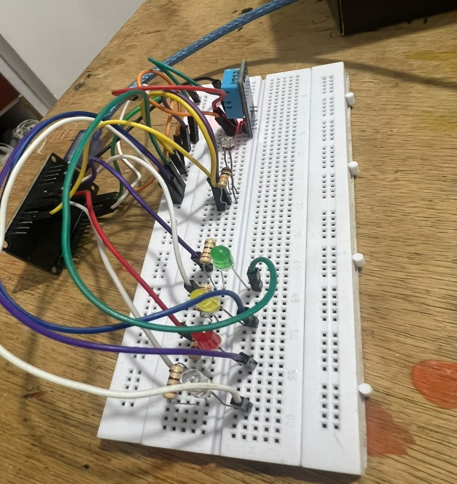

*Montaje físico del sistema (ESP32, LDR y componentes de las semanas anteriores).*

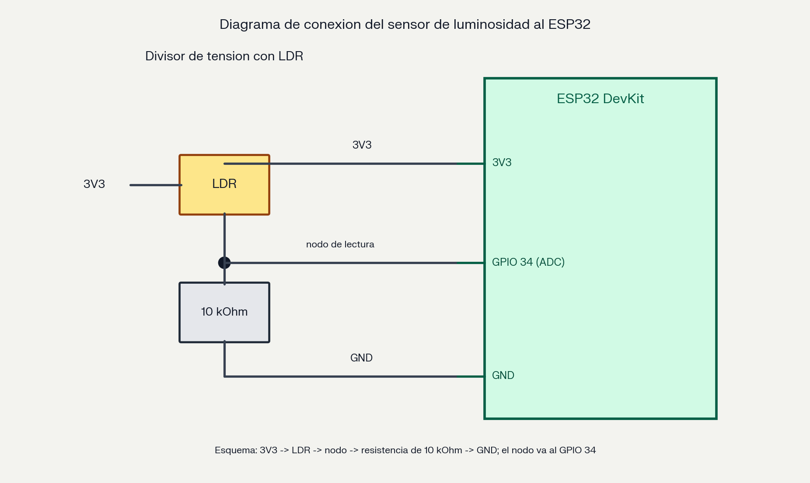

*Diagrama de conexión del sensor LDR al ESP32 (divisor de tensión en GPIO 34).*

Se verificó en el Monitor Serial que la lectura varía al cubrir y descubrir el sensor: con luz artificial marca entre 1323 y 1458, y al taparlo baja a valores entre 23 y 30.

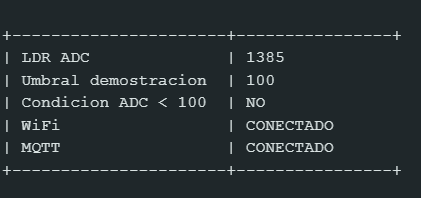

*Monitor Serial: lectura del LDR y publicación (captura 1 de 3).*

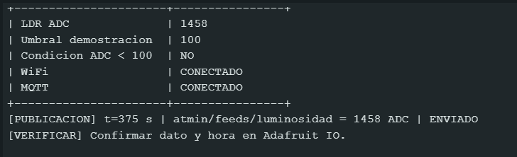

*Monitor Serial: lectura del LDR y publicación (captura 2 de 3).*

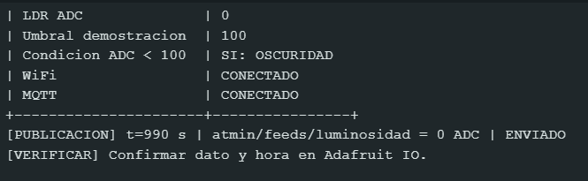

*Monitor Serial: lectura del LDR y publicación (captura 3 de 3).*


### 6.2 Configuración de Adafruit IO

Se usó el feed luminosidad, creado en la semana 12 en la cuenta de Adafruit IO del equipo, por lo que no se creó uno nuevo. Las credenciales se guardan en el archivo config.h (AIO_USERNAME y AIO_KEY), que no se sube a GitHub; el servidor es io.adafruit.com, puerto 1883.

| Parámetro | Valor |
|---|---|
| Servidor MQTT | io.adafruit.com |
| Puerto | 1883 (autenticado, sin cifrado) |
| Autenticación | Usuario de la cuenta y AIO Key (en config.h) |
| Feed | luminosidad (tópico usuario/feeds/luminosidad) |
| Unidad publicada | ADC (0 a 4095) |

La guía pide capturas de la creación del feed. Como el feed ya existía, la evidencia son las capturas del feed recibiendo datos reales.


### 6.3 Fase 2: código y publicación de datos

El código base es el de la semana 12, simplificado para esta actividad. Los cambios fueron:

| Aspecto | Semana 12 | Semana 13 |
|---|---|---|
| Sensores | DHT11 y LDR | Solo LDR |
| Feeds | temperatura, humedad, luminosidad, led-rojo, buzzer | Solo luminosidad |
| Publicación | Cada 15 s | Cada 15 s (dentro del rango de 10 a 15 s de la guía) |
| Actuadores | Switches desde el dashboard | Ninguno; LED blanco local con ADC < 100 |
| Reconexión | WiFi y MQTT | WiFi y MQTT sin bloquear el programa |
| Credenciales | config.h | config.h (fuera de GitHub) |

- No hay esperas largas: solo pausas de 5 ms entre muestras y de 1 ms por ciclo, de modo que la conexión MQTT se mantiene atendida con mqtt.loop().
- La función de reconexión se ejecuta sin bloquear: si cae el WiFi o MQTT, reintenta cada 15 s.
- El Monitor Serial imprime la lectura, la condición ADC < 100 y cada publicación con su hora.
- Comandos de apoyo: d (desconectar WiFi), k (desconectar MQTT), m e i (datos de conexión) y p (solicitar envío).


### 6.4 Validación en la nube

Se abrió Adafruit IO y se confirmó que los datos llegan al feed con fecha y hora recientes, y que el valor publicado coincide con el que imprime el Monitor Serial.


*Adafruit IO: feed luminosidad con datos recientes (captura 1 de 2).*

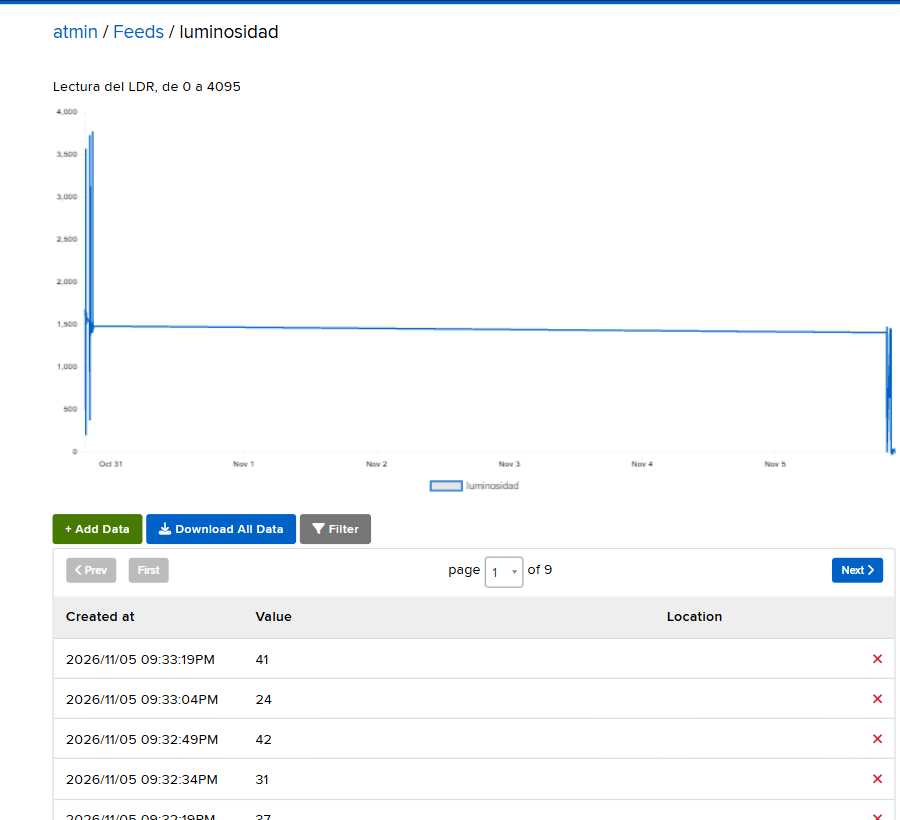

*Adafruit IO: feed luminosidad con datos recientes (captura 2 de 2).*


### 6.5 Fase 3: visualización histórica

Se creó un dashboard en Adafruit IO y se añadió un Line Chart asociado al feed luminosidad, con el título «Luminosidad relativa del aula» y el eje Y rotulado como ADC (0–4095). El sistema se dejó funcionando al menos cinco minutos mientras se cubría y descubría el sensor.

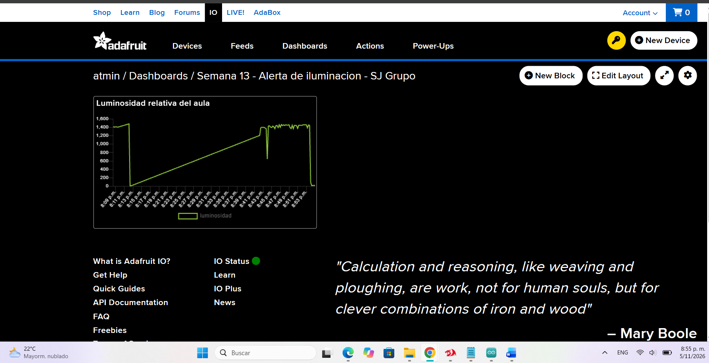

*Dashboard de Adafruit IO con el gráfico de luminosidad.*

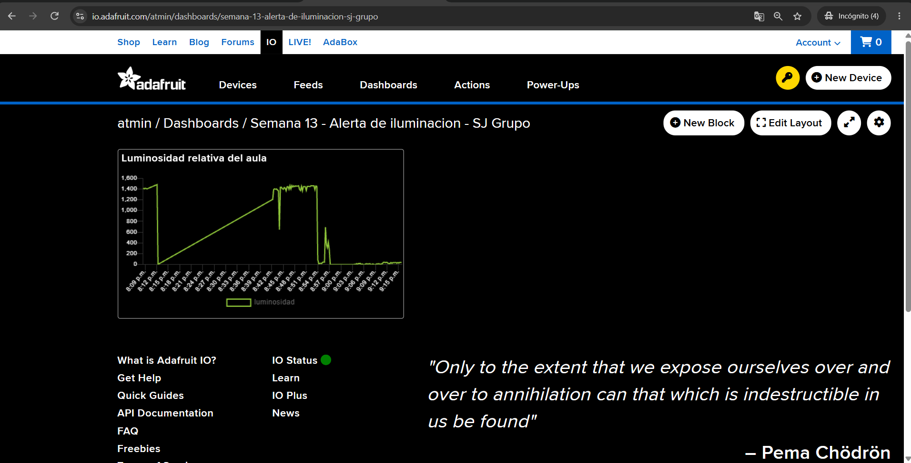

*Histórico de luminosidad (Line Chart) con la prueba de cubrir y descubrir el sensor.*

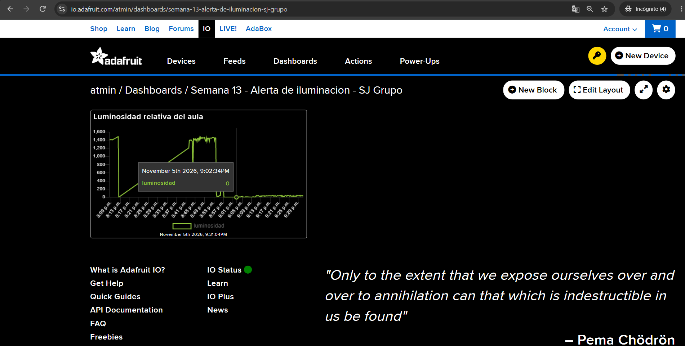

*Dato más bajo del histórico.*


### Análisis de tendencia

¿La luminosidad se mantuvo estable o presentó picos? Con la luz artificial constante de la habitación, la lectura se mantuvo estable en un rango alto, entre 1323 y 1458 ADC. Los cambios importantes ocurrieron solo cuando se cubrió el sensor: la curva descendió bruscamente hasta valores de 23 a 30 ADC y volvió a subir al descubrirlo; esos descensos son los únicos picos observados.


¿En qué momento del día se detectó el valor más bajo? La prueba se hizo en la noche del 5 de noviembre de 2026, con luz artificial. El valor más bajo no corresponde a un momento natural del día, sino al instante en que se tapó el sensor; por eso el histórico de esta práctica muestra el efecto de la acción y no una tendencia diaria de la luz.


### 6.6 Fase 4: automatización con IFTTT

Se creó el Applet «SJ Grupo - Alerta de oscuridad con LDR» con el modelo Trigger-Action:

| Parte | Servicio | Configuración |
|---|---|---|
| Trigger (This) | Adafruit → Monitor a feed on Adafruit IO | Feed luminosidad; operador Less than; valor 100 |
| Action (That) | Notifications → Send a notification from the IFTTT app | Mensaje con alerta, valor actual del feed y verificación de iluminación |

Mensaje de la notificación (con el ingrediente del valor del feed, que IFTTT ofrece como FeedValue):

```text
ALERTA: Luminosidad baja en el aula.
Lectura del LDR: [valor del feed] ADC.
Umbral de demostracion: menor que 100 ADC.
Verificar iluminacion.
```

El mensaje indica ADC y no lux, de acuerdo con la sección 4.

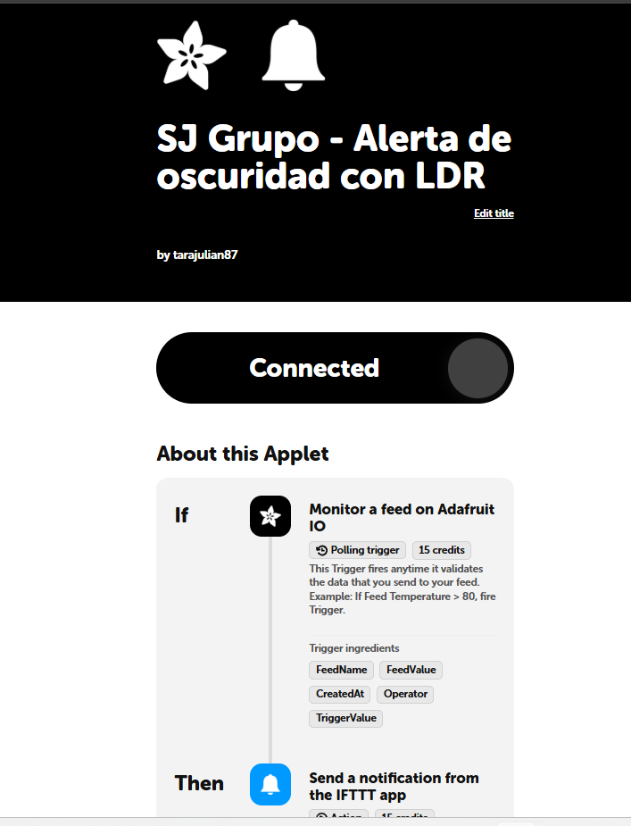

*Applet de IFTTT «SJ Grupo - Alerta de oscuridad con LDR».*

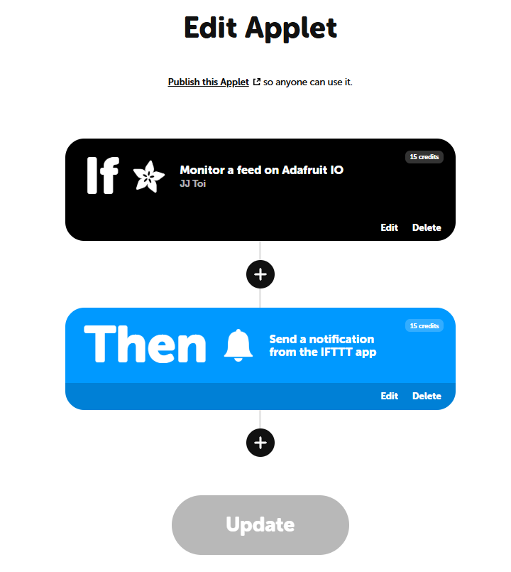

*IFTTT: configuración del Applet y de la aplicación móvil (captura 1 de 2).*

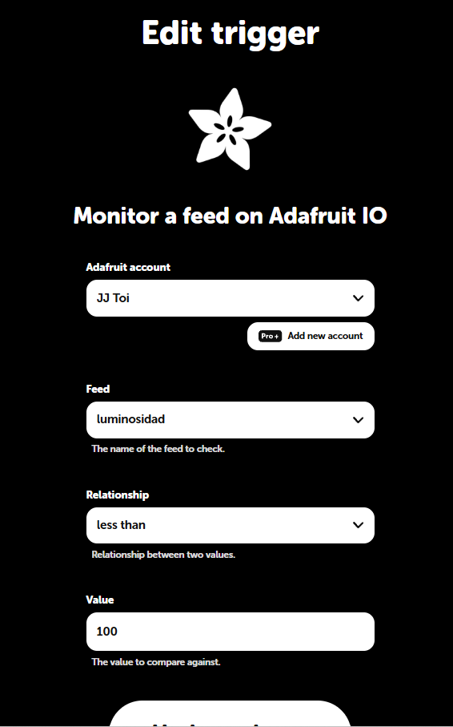

*IFTTT: configuración del Applet y de la aplicación móvil (captura 2 de 2).*

El disparador de Adafruit es de tipo consulta periódica (polling): IFTTT revisa el feed cada cierto tiempo, y en el plan gratuito esa comprobación puede ser una vez por hora (IFTTT, s. f.-a). Publicar cada 15 s mantiene el feed actualizado, pero no hace que IFTTT lo consulte con esa frecuencia. Además, desde octubre de 2026 cada paso de un Applet consume créditos (15 por el disparador y 15 por la acción en este Applet) y, si se agotan, los Applets se pausan (IFTTT, 2026).


### 6.7 Prueba de la alerta

Se cubrió el LDR para producir una lectura menor que 100 y se revisó la actividad del Applet en IFTTT (IFTTT, s. f.-b).


### Primer intento: falló la acción

El 5 de noviembre a las 20:49 el registro de actividad mostró que el disparador de Adafruit se ejecutó correctamente (15 créditos), pero la acción de notificación falló (0 créditos), con este mensaje: «Para solucionarlo, descarga e inicia sesión en la aplicación móvil IFTTT». Es decir, la condición del feed se detectó, pero IFTTT no encontró una sesión móvil válida para entregar la notificación.

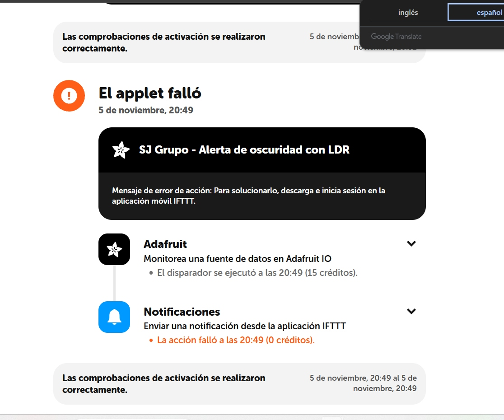

*Registro de actividad de IFTTT (5 de noviembre, 20:49): el disparador de Adafruit se ejecutó y la acción de notificación falló.*

Solución aplicada: se comprobó que la aplicación IFTTT del celular estuviera instalada e iniciada con la misma cuenta que creó el Applet, se cerró sesión y se volvió a entrar, se verificó que el Applet apareciera dentro de la aplicación y se activaron las notificaciones del teléfono para IFTTT.


### Nueva ejecución

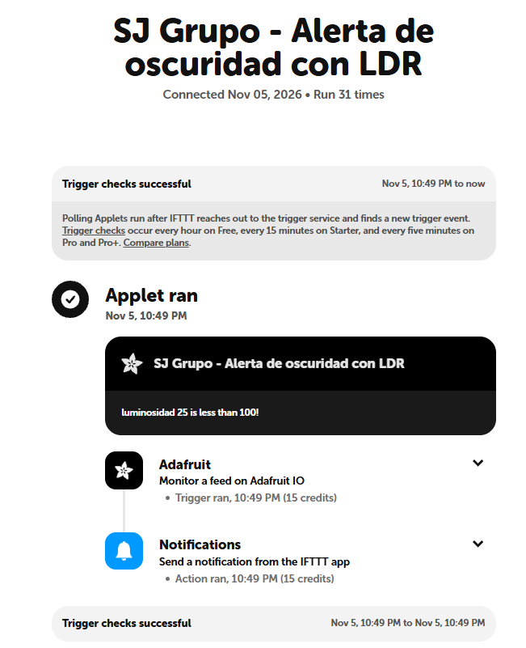


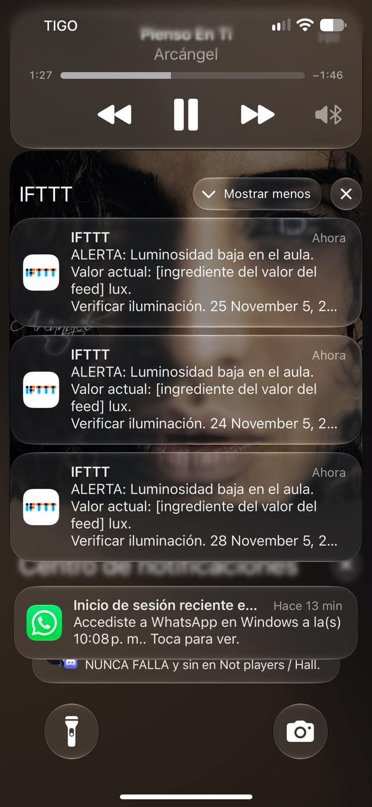


## 7. Resultados de las pruebas

| Prueba | Resultado | Evidencia |
|---|---|---|
| La lectura del LDR varía al cubrir y descubrir | Correcto: 1323–1458 ADC descubierto; 23–30 ADC tapado | Monitor Serial |
| Publicación en el feed luminosidad | Correcto: datos con hora reciente | Feed de Adafruit IO |
| Histórico de al menos cinco minutos | Correcto | Line Chart |
| Applet de IFTTT configurado y activo | Correcto: estado Connected | Applet |
| Disparador de IFTTT (feed < 100) | Se ejecutó (5 de noviembre, 20:49) | Actividad de IFTTT |
| Acción de notificación, primer intento | Falló por falta de sesión en la aplicación móvil | Actividad de IFTTT |
| Notificación push recibida | COMPLETAR | Captura del celular |


## 8. Problemas encontrados y soluciones

| Problema | Causa | Solución |
|---|---|---|
| El LDR no mide lux | Su lectura es ADC y exige calibración con una referencia | Trabajar con ADC y declarar la diferencia con el enunciado |
| La alerta de IFTTT no es inmediata | El disparador es de consulta periódica (en el plan gratuito, hasta una hora) | Documentar la limitación y mantener publicaciones nuevas por debajo del umbral |
| Falló la acción de notificación | IFTTT no tenía una sesión válida de la aplicación móvil | Cerrar e iniciar sesión con la misma cuenta, verificar el Applet en la aplicación y habilitar las notificaciones |
| Consumo de créditos de IFTTT | Cada paso exitoso consume créditos y al agotarse se pausan los Applets | Hacer pocas pruebas y desactivar el Applet al terminar |
| El enunciado menciona la librería Adafruit_MQTT.h | Ya existía un código funcional con PubSubClient | Mantener PubSubClient, con el mismo broker y la misma autenticación |


## 9. Preguntas de reflexión


### 1. ¿Qué ventaja ofrece IFTTT frente a programar el envío de correos directamente desde el ESP32?

IFTTT separa la captura de datos de la automatización. El ESP32 solo publica el dato; la plataforma evalúa la condición y envía la notificación, sin que el dispositivo tenga que implementar un cliente de correo con su servidor, autenticación y cifrado, ni almacenar contraseñas de correo. Además, se puede cambiar la regla, el umbral o la acción desde la plataforma, sin volver a programar el ESP32. A cambio, se depende de Internet, de los límites del servicio y de su intervalo de consulta.


### 2. ¿Por qué es importante que el ESP32 publique datos con una frecuencia adecuada (10–15 s) para que IFTTT funcione correctamente?

Porque IFTTT solo ve los datos que están en el feed. Si el ESP32 publica con muy poca frecuencia, una condición baja puede ocurrir y desaparecer entre dos publicaciones, y nunca ser registrada. Si publica con demasiada frecuencia, se supera el límite de datos por minuto de Adafruit IO y las publicaciones se rechazan. El intervalo de 15 s mantiene el feed actualizado y respeta el límite. Aun así, esa frecuencia no determina cada cuánto consulta IFTTT: ese intervalo depende de su plan.


### 3. ¿Qué otras acciones (That) podrían configurarse en IFTTT además de la notificación push, y cómo beneficiarían al proyecto integrador?

Según los servicios disponibles en la cuenta, se podría enviar un correo al coordinador, registrar cada evento en una hoja de cálculo para conservar un historial de incidentes, o enviar un mensaje por una aplicación de mensajería. Para el proyecto integrador, eso permitiría avisar a más personas, dejar un registro duradero que no dependa de la retención del plan gratuito de Adafruit IO y, en el futuro, encadenar acciones. Son propuestas: no se implementaron en esta práctica.


### 4. ¿Qué limitaciones encontró al usar la versión gratuita de Adafruit IO (por ejemplo, retención de datos de 30 días)?

La guía señala una retención de 30 días, por lo que un histórico anual exigiría exportar o guardar los datos en otro lugar. También hay un límite de datos por minuto, que obliga a publicar con calma, y un límite de feeds por cuenta. En esta práctica, además, aparecieron limitaciones del servicio de IFTTT: consulta periódica del disparador, créditos por ejecución y la necesidad de una sesión válida en la aplicación móvil. Por último, el LDR no entrega lux, lo que limita la fidelidad de la alerta frente al enunciado.


## 10. Cumplimiento de la rúbrica

| Criterio | Ponderación | Evidencia | Archivo |
|---|---|---|---|
| Conexión correcta del sensor y lectura de datos | 15 % | Código y Monitor Serial | codigo/esp32_luminosidad.ino; monitor_serial_*.png |
| Publicación exitosa en Adafruit IO | 20 % | Captura del feed con datos en tiempo real | feed_adafruit_*.png |
| Visualización histórica (Line Chart) | 15 % | Captura del gráfico con tendencia | grafico_historico.png; dato_mas_bajo.png |
| Applet de IFTTT configurado correctamente | 20 % | Captura del Applet activo | applet_ifttt.png |
| Notificación push recibida en el celular | 15 % | Captura de pantalla del celular | notificacion_push.png (pendiente de reemplazar) |
| Documentación en GitHub (README + evidencias) | 15 % | Enlace al repositorio | README.md; informe_tecnico.md; evidencias/ |


## 11. Conclusiones

- El flujo Sensor → ESP32 → Adafruit IO → IFTTT quedó construido: el ESP32 publica lecturas reales del LDR y el Applet de IFTTT detectó la condición del feed el 5 de noviembre a las 20:49.
- La automatización es útil porque el coordinador no necesita mirar el dashboard: la plataforma vigila el dato y avisa solo cuando se cumple la regla, y se puede cambiar el umbral o la acción sin tocar el firmware.
- Hay que conocer las limitaciones del servicio: el disparador es de consulta periódica y puede tardar hasta una hora en el plan gratuito, los Applets consumen créditos y la notificación depende de una sesión válida en la aplicación móvil.
- La práctica se hizo con valores ADC y no con lux, porque el LDR no calibrado no entrega esa unidad; esa diferencia con el enunciado debe confirmarse con el docente.
- El histórico de Adafruit IO permitió comprobar que la luz se mantuvo estable y que los descensos corresponden a las veces que se tapó el sensor.


## 12. Referencias

- Adafruit Industries. (s. f.). Adafruit IO MQTT API. https://io.adafruit.com/api/docs/mqtt.html
- Cooper, J. (2015). Adafruit IO. Adafruit Learning System. https://learn.adafruit.com/adafruit-io
- DigiKey. (s. f.). Design a luxmeter with an LDR and an Arduino. https://www.digikey.com/en/maker/projects/design-a-luxmeter-with-an-ldr-and-an-arduino/623aeee0f93e427bb57e02c4592567d1
- Espressif Systems. (s. f.). ADC. Arduino-ESP32 documentation. https://docs.espressif.com/projects/arduino-esp32/en/latest/api/adc.html
- IFTTT. (s. f.-a). Understanding the "Service took too long to respond" error. IFTTT Help Center. https://help.ifttt.com/hc/en-us/articles/43512544764315-Understanding-the-Service-took-too-long-to-respond-Error
- IFTTT. (s. f.-b). How to use the IFTTT Activity feed. IFTTT Help Center. https://help.ifttt.com/hc/en-us/articles/115004914234-How-to-use-the-IFTTT-Activity-feed
- IFTTT. (2026). What are credits and how do they work? IFTTT Help Center. https://help.ifttt.com/hc/en-us/articles/57322299076763-What-are-credits-and-how-do-they-work
- O’Leary, N. (s. f.). PubSubClient: A client library for MQTT messaging [Software]. GitHub. https://github.com/knolleary/pubsubclient
